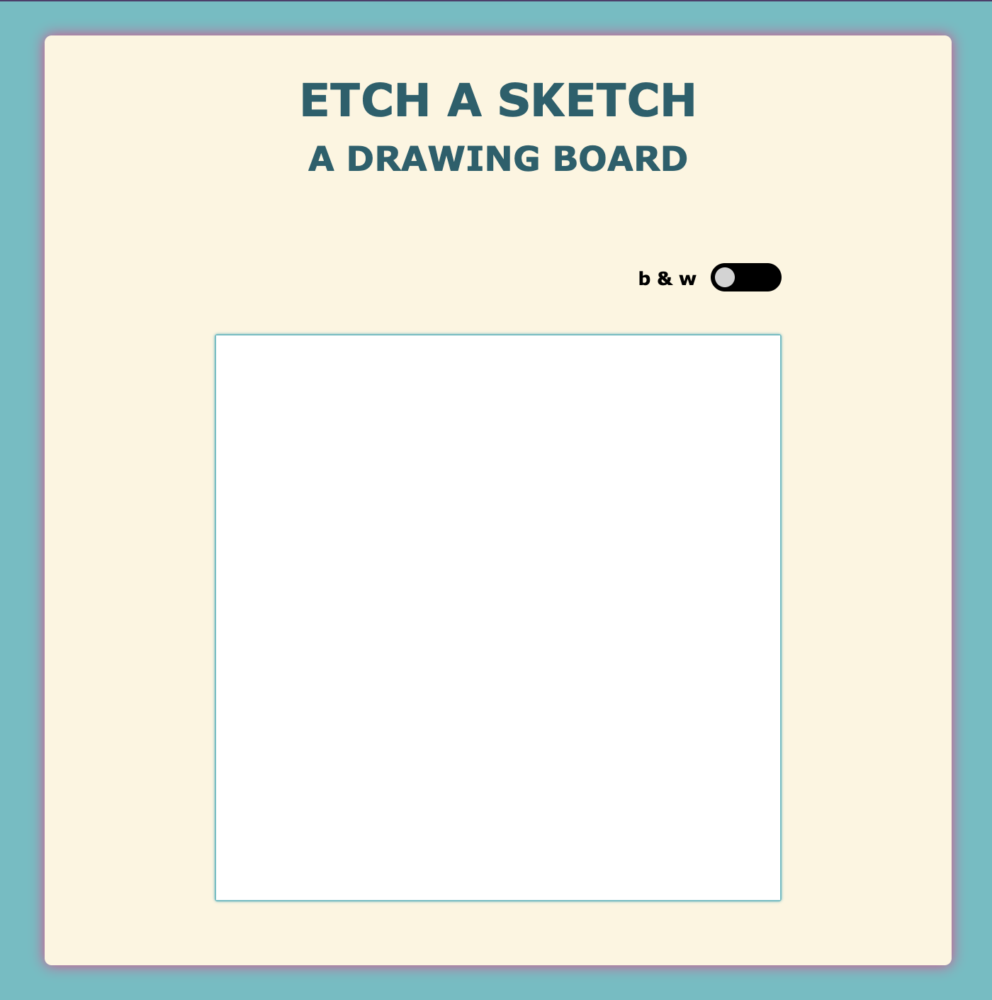

# Etch a Sketch

A lightweight, dependency-free drawing board that runs entirely in the browser. Hover and click to draw grayscale shading, or flip the switch to paint in random colors. This project was developed while I was learning JavaScript with the [The Odin Project](<https://www.theodinproject.com/>) Foundations curriculum.




## ✨ Features

- **100 × 100 pixel board** (10,000 squares) rendered with vanilla JavaScript.
- **Click and drag** to draw with the mouse.
- **Touch support** to draw with your finger on phones and tablets.
- **Two drawing modes** via a toggle switch:
  - **B&W:** Each pass darkens a pixel through a grayscale sequence.
  - **Color:** Every pass paints a random RGB color.
- **Accessible toggle:** Keyboard focusable, with an `aria-label` and visible focus indicator.
- **Zero dependencies** and no build step required.
- **Compatible** with all modern evergreen browsers: Google Chrome, Microsoft Edge, Mozilla Firefox, and Apple Safari. Uses modern CSS features.


## 🚀 Getting Started

Clone the repository:

bash

```bash
git clone https://github.com/tiagormacedo/web-applets.git
```

Navigate into the project directory:

bash

```bash
cd web-applets/etch-a-sketch
```

Open `index.html` directly in your browser, or serve the project locally:

bash

```bash
npx serve .
```


## 🕹️ Usage

| Action | Result |
| --- | --- |
| Click or tap a pixel | Paints it once |
| Hold and drag (mouse) | Enables continuous drawing |
| Drag your finger (touch) | Enables continuous drawing |
| Toggle the switch | Switches between B&W and Color modes |
| Re-trace a pixel (B&W) | Darkens it step by step, eventually returning it to white |


## 🧠 How It Works

The project is built with three simple files:

- **`index.html`:** Provides the static HTML structure. The board and controls are generated dynamically using JavaScript.
- **`style.css`:** Defines the visual palette using CSS custom properties. The board uses CSS Grid.
- **`script.js`:** Handles board generation, drawing interactions, and mode switching.


## 📁 Project Structure

```text
etch-a-sketch/
├── index.html
├── readme.md
├── screenshot web app.png
├── script.js
└── style.css
```


## ⚠️ Known Limitations

- Very high grid densities (thousands of squares) may affect performance. A `<canvas>` implementation would be more suitable for significantly larger grids.
- No dedicated eraser button. In B&W mode, retracing a pixel eventually returns it to white.
- No undo functionality.
- No save or export functionality.


## 🔒 Security

This is a fully static project with no user input, network requests, or third-party scripts. If you extend the project with additional features (such as a custom grid-size prompt):
- Validate and clamp all numeric input.
- Continue using `createElement()` and `textContent` instead of `innerHTML` when creating or updating DOM elements.


## 📄 License

This project is licensed under the [MIT License](<https://opensource.org/license/mit/>).
