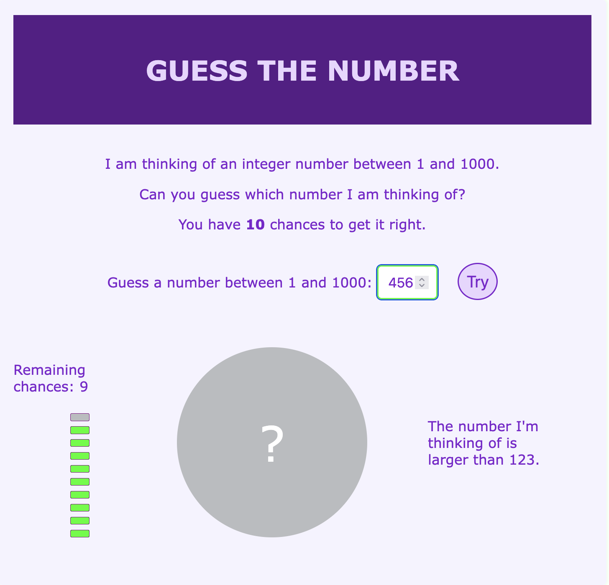

# Guess the number

[](https://tiagormacedo.github.io/web-applets/guess-the-number/)
[](https://github.com/tiagormacedo/web-applets/blob/main/LICENSE)

A simple browser‑based game where the player tries to guess a hidden number between 1 and 1000 (inclusive) in at most 10 attempts. This is a simple project built with plain HTML, CSS, and JavaScript (no dependencies, no build step), and created while I was learning JavaScript.



[▶ Live demo](https://tiagormacedo.github.io/web-applets/guess-the-number/)


## 🕹️ How to play

1. Enter a number between 1 and 1000 in the input field.
2. Click on the "Try" button or press enter to submit your guess.
3. After each guess, the game tells you whether the secret number is larger or smaller than your guess, and how many attempts are left.
4. Invalid input (nonintegers or out-of-range values) shows an error message and does not consume an attempt.
5. Guess correctly within 10 attempts and you win. If you run out of attempts, the secret number is revealed and the round ends. To start a new round, use the "Play again" button.


## 📁 Project structure

``` text
guess-the-number/
├── index.html        # Main page markup
├── README.md         # This file
├── screenshot.png    # Screenshot of the rendered app
├── script.js         # Game logic, secret number, input validation, attempts, etc
└── style.css         # Styling of the main page
```


## 🚀 Installation

1. Clone this repository (the game lives in the `guess-the-number/` folder), or directly download the files `index.html`, `style.css`, and `script.js`.
2. Open `index.html` in any modern web browser (no build step or external dependencies are required).


## ✨ Features

- Randomly generated secret number between 1 and 1000.
- Input validation: nonintegers and out-of-range values are rejected with an error message.
- Visual feedback after each guess: larger/smaller hint and remaining attempts.
- Responsive layout that works on desktop and mobile.
- Play-again functionality to restart the round.


## ⚙️ Technical details

- **HTML (`index.html`).** Page structure: introduction, guess form, sections for attempts, the secret number (revealed at the end of a round), and status messages.

- **CSS (`style.css`).** CSS custom properties for theming, a responsive flexbox layout, and styles for error messages, attempt indicators, and buttons.

- **JavaScript (`script.js`).** Game logic, generating the secret number, validating input, tracking attempts, updating the UI, and handling win/lose/restart states.


## 📜 License

This project is released under the [MIT License](../LICENSE).
