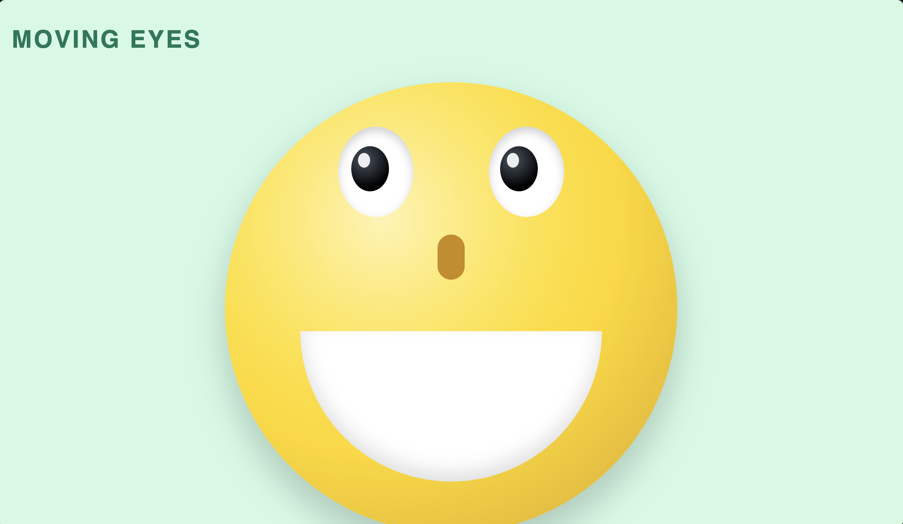

# Moving eyes 👀

[](https://tiagormacedo.github.io/web-applets/moving-eyes/)
[](https://github.com/tiagormacedo/web-applets/blob/main/LICENSE)

A cartoon face whose eyes follow your cursor. This is a simple project built with plain HTML, CSS, and JavaScript (no dependencies, no build step), and created while I was learning JavaScript.



[▶ Live demo](https://tiagormacedo.github.io/web-applets/moving-eyes/)


## 🚀 Usage

1. Clone or download this repository.  
2. Open the `index.html` file in any modern browser (Chrome, Firefox, Safari, Edge).  
3. Move your mouse across the page and the eyes will follow the cursor. On a touch screen, press and drag your finger.
.


## 📁 Project structure

``` text
moving-eyes/
├── index.html          # Main page markup
├── README.md           # This file
├── screenshot.png      # Screenshot of the rendered app
├── script.js           # Pointer tracking and iris movement
└── style.css           # Styling of the main page
```


## ✨ Features

- Eyes track the pointer anywhere on the page.  
- The face scales with the viewport.  
- Respects the `prefers-reduced-motion` media query.  


## ⚙️ Technical details

The JavaScript attaches a `pointermove` listener to the document. When the pointer moves, the script calculates the cursor's coordinates relative to each eye and updates the iris position using CSS `transform: translate(...)`. The face is a `<div>` that holds two eye `<div>`s, each of which contains an inner iris `<div>` that is repositioned inside its eye. CSS media queries handle responsive scaling and the reduced-motion preference.


## 📜 License

This project is licensed under the [MIT License](../LICENSE).
